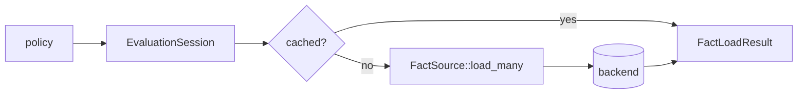

# Gatehouse

[](https://github.com/thepartly/gatehouse/actions/workflows/ci.yml) [](https://crates.io/crates/gatehouse) [](https://docs.rs/gatehouse) [](https://crates.io/crates/gatehouse) [](LICENSE)


Gatehouse is an in-process authorization library for Rust. You write policies as Rust code, register them on a `PermissionChecker`, and ask whether a subject may perform an action on a resource. There is no policy language, server or sidecar, and Gatehouse does not store your users, roles or relationships: policies read them per request, through code you provide.

- **Typed.** One `PolicyDomain` fixes the subject, action, resource and context types for a set of policies.
- **Deny overrides, default deny.** Vetoes beat grants, and no grant means no access.
- **Honest about outages.** A decision is `Granted`, `Denied` or `Indeterminate`, so a failed backend lookup becomes a 503 rather than a silent denial.
- **Built for lists.** Backend data is loaded through request-scoped, batched fact sources, and list endpoints are filtered strictly.
- **Auditable.** Every decision carries a trace naming the policy that decided and the facts it consulted.

Upgrading from 0.5.1? 0.6 is a breaking release, and some changes alter results during backend outages. Read [MIGRATION.md](MIGRATION.md) and the [changelog](CHANGELOG.md).

## When to use it

Gatehouse fits when:

- authorization rules are clearer, and easier to test, as Rust code than as configuration;
- decisions depend on data your service already owns, such as ownership, tenancy or relationships;
- list endpoints must return only what the caller may see, without an N+1 query per row.

It is probably not the right tool when you need a policy language, a central policy service shared with services written in other languages, a managed relationship store, or policy changes that ship without a deploy. It also does not authenticate callers: it takes an already-authenticated subject.

## Quick start

Create a binary crate with `cargo new gatehouse-quickstart`, then add these dependencies to `Cargo.toml`:

```toml
[dependencies]
gatehouse = "=0.6.0"
tokio = { version = "1", features = ["macros", "rt"] }
```

Replace `src/main.rs` with this program and run `cargo run`:

```rust
use gatehouse::{AccessError, EvaluationSession, PermissionChecker, PolicyBuilder, PolicyDomain};

struct User {
    id: u64,
}

struct Document {
    owner_id: u64,
}

struct Read;
struct Documents;

impl PolicyDomain for Documents {
    type Subject = User;
    type Action = Read;
    type Resource = Document;
    type Context = ();
}

#[tokio::main(flavor = "current_thread")]
async fn main() -> Result<(), AccessError> {
    let owner_policy = PolicyBuilder::<Documents>::new("Owner")
        .when(|user, _action, document, _context| user.id == document.owner_id)
        .build();
    let mut checker = PermissionChecker::<Documents>::new();
    checker.add_policy(owner_policy);

    let user = User { id: 7 };
    let document = Document { owner_id: 7 };
    let session = EvaluationSession::empty();
    let bound = checker.bind(&session, &user, &Read, &());

    bound.authorize(&document).await?;
    println!("Access granted");
    Ok(())
}
```

A `PolicyDomain` names the four types in a decision: the `Subject` asking, the `Action` attempted, the `Resource` acted on, and a request `Context` such as the time or a tenant setting. A `PermissionChecker` holds the policies for one domain, and `bind` fixes the request-wide inputs so that one or many resources can be checked against them. `EvaluationSession::empty()` suits policies that read no backend data; [request-scoped facts](#request-scoped-facts) covers the rest.

From here, read [Core concepts](#core-concepts), or run the [examples](#examples).

## Core concepts

### Grants, vetoes and outcomes

A `Policy` returns a `GrantResult`: grant, abstain, or indeterminate. A `VetoPolicy` returns a `VetoResult`: veto, pass, or indeterminate. Register them with `add_policy` and `add_veto`. The types stop a grant policy from vetoing and a veto policy from granting.

The checker runs every veto before any grant:

| Situation | Result |
| --- | --- |
| A veto matches | `Denied`, even if another veto could not be evaluated |
| No veto matches, but one could not be evaluated | `Indeterminate`: grants are blocked |
| No veto matches and a grant matches | `Granted`, even if another grant could not be evaluated |
| No grant matches and a policy could not be evaluated | `Indeterminate` |
| Otherwise, including a checker with no policies | `Denied` |

`Indeterminate` never grants. It means a policy that mattered could not be decided, usually because a fact backend failed.

### Handling denials and outages

Bind the request-wide inputs once, then evaluate:

```rust,ignore
let bound = checker.bind(&session, &subject, &action, &request_context);

bound.authorize(&resource).await?;           // Result<(), AccessError>
let decision = bound.check(&resource).await; // AccessEvaluation
```

`authorize`, and `AccessEvaluation::into_result` on an existing decision, return `Ok(())`, `AccessError::Denied` or `AccessError::Indeterminate`. Each error carries the reason, the trace and the failed fact loads. Map a denial to 403 and an indeterminate result to 503:

```rust
use gatehouse::{AccessError, AccessEvaluation};

fn http_status(evaluation: AccessEvaluation) -> u16 {
    match evaluation.into_result() {
        Ok(()) => 200,
        Err(AccessError::Denied { .. }) => 403,
        Err(_) => 503,
    }
}
```

Keep backend diagnostics in logs and internal traces, not in response bodies. `AccessEvaluation`, `GrantResult` and `VetoResult` are `#[must_use]`, so ignoring a decision warns.

### Request-scoped facts

Backend-loaded data such as relationships belongs in facts, not in `Context`. A policy asks for a fact with `ctx.fact(key).await`, which returns `FactLoadResult::Found`, `Missing` or `Error`. An `EvaluationSession` serves the request: it deduplicates keys, caches results, joins concurrent loads of the same key, and hands unique keys to your `FactSource::load_many` in batches, so a list of 100 items costs one backend query rather than 100.



Sources are registered once, and each request gets a fresh session. A `FactSource` must return exactly one result per key, in order:

```rust,ignore
type Viewer = RelationshipQuery<UserId, ProjectId, Relation>;

#[async_trait]
impl FactSource<Viewer> for RelationshipStore {
    async fn load_many(&self, keys: &[Viewer]) -> Vec<FactLoadResult<bool>> {
        // One backend query for all keys.
    }
}

// At startup:
let registry = FactRegistry::builder().with::<Viewer, _>(store).build();
checker.add_policy(RebacPolicy::<Projects, UserId, ProjectId, Relation>::new(
    |user| user.id,
    |project| project.id,
    Relation::Viewer,
));

// Per request:
let session = registry.session();
```

Facts loaded through `ctx.fact`, `ctx.facts` and `ctx.facts_by` are recorded in the decision trace. A failed load turns an abstention or a veto pass into `Indeterminate`, while a decisive grant or veto still stands. `ctx.session()` gives raw access to the session and bypasses recording, so prefer `ctx.fact`. Sessions cache for one request, so permission changes are seen by the next session.

### List endpoints

When the application already has the candidate resources, use `try_filter`, or `try_filter_by` when each item is a wide row and the resource is a projection of it:

```rust,ignore
let visible_posts = bound.try_filter(posts).await?;
let visible_rows = bound.try_filter_by(rows, |row| &row.authz_resource).await?;
```

Both return the granted items and exclude definite denials. If any decision is indeterminate they return a `FilterError` instead, which holds every original item and decision; its `indeterminate()` iterator selects the unresolved items. A list is never quietly shortened by an outage. `evaluate` and `evaluate_by` return every item with its full decision, in input order.

When the candidate set is too large to load first, implement `LookupSource` to enumerate candidate IDs and `Hydrator` to load them, then page:

```rust,ignore
let page = bound
    .try_lookup_page(&lookup, &hydrator, cursor.as_deref(), limit)
    .await?;
```

A `LookupSource` must enumerate a superset of every resource that any policy could grant for the bound subject, action and context. Lookup narrows candidates; it does not replace the policies. If evaluation is indeterminate, the error retains the hydrated resources and returns no next cursor: retry the same cursor with a fresh session after recovery. A page with more IDs than the requested limit is rejected with `LookupPageTooLarge`.

`filter_lossy`, `filter_by_lossy` and `lookup_page_lossy` deliberately omit indeterminate items along with denials. The older `filter`, `filter_by` and `lookup_page` names behave the same way and are deprecated.

### Long-lived streams

For SSE, WebSocket and other long-lived streams, do not keep one fact-backed session for the stream's lifetime. To authorize once at open, use a fresh session to compute the visible set with `try_filter`, drop the session, and emit frames only for that set. To observe revocation mid-stream, reauthorize periodically with a fresh session each time.

## Writing policies

### PolicyBuilder

`PolicyBuilder` builds policies from synchronous predicates over the subject, action, resource and context. `build` makes a grant and `build_veto` makes a veto:

```rust,ignore
let owner = PolicyBuilder::<Documents>::new("Owner")
    .when(|user, _action, document, _context| user.id == document.owner_id)
    .build();
checker.add_policy(owner);

let suspended = PolicyBuilder::<Documents>::new("Suspended")
    .subjects(|user| user.suspended)
    .build_veto();
checker.add_veto(suspended);
```

Predicates combine with AND, including repeated calls on the same axis, so an extra predicate only narrows a grant and makes a veto fire less often. To broaden a grant, build one policy per condition and combine them with `PolicyExt::or`; to broaden a veto, use `VetoPolicyExt::any_of`.

`build` and `build_veto` require at least one predicate. A policy that applies to every request is written with `allow_all()` or `forbid_all()`, so an empty builder cannot create unrestricted authority by accident.

### Custom policies

Implement `Policy` for asynchronous grants, or `VetoPolicy` for asynchronous vetoes. Both support custom batching and security-rule metadata.

```rust,ignore
struct OwnerPolicy;

#[async_trait]
impl Policy<Documents> for OwnerPolicy {
    async fn evaluate(&self, ctx: &EvalCtx<'_, Documents>) -> GrantResult {
        if ctx.subject.id == ctx.resource.owner_id {
            ctx.grant("subject owns the document")
        } else {
            ctx.not_applicable("subject does not own the document")
        }
    }

    fn policy_type(&self) -> Cow<'static, str> {
        Cow::Borrowed("OwnerPolicy")
    }
}
```

When calling a policy directly rather than through a checker, pass its result through `ctx.finish(result)` to attach recorded facts.

### Built-in policies

- `RbacPolicy`: grants when the subject holds at least one role required for the `(action, resource)` pair.
- `RebacPolicy`: grants when the session loads `Found(true)` for a `RelationshipQuery` from a registered `FactSource`. `Found(false)` and `Missing` abstain; a missing source, a backend error or a source contract violation is indeterminate.
- `DelegatingPolicy`: maps the inputs into another `PolicyDomain` and delegates to a child `PermissionChecker`. Register it with `add_delegate` to install its grants and vetoes together.

### Combinators

Grants compose with `PolicyExt`:

```rust,ignore
let rule = is_editor.and(is_locked.not()).or(admin_override);
checker.add_policy(rule);
```

`not()` inverts grants and abstentions but keeps uncertainty, so use `grant.and(blocked.not())` for an exclusion that applies to one grant only. `AndPolicy::try_new` and `OrPolicy::try_new` build from nonempty collections.

Vetoes cannot be mixed into grant combinators. Use `AllOfVeto` (`VetoPolicyExt::all_of`) when every child must veto, or `AnyOfVeto` (`VetoPolicyExt::any_of`) when any child veto suffices. There is no veto negation.

A decision names the policy that decided. `or` and `any_of` name the first child that decided, with its reason; `and`, `not` and `all_of` name themselves. Call `.named(...)` on a combinator to give it a stable name, and use `grant_path()` and `forbidden_path()` on a decision for the full route.

## Audit traces and telemetry

Every `AccessEvaluation` carries an `EvalTrace` with the policy tree that was evaluated and the provenance of each fact consulted. Enable the `serde` feature to serialize traces for audit logs.

With the default `tracing` feature, evaluation records spans for single and batch checks, and each evaluated policy emits a `trace!` event on the `gatehouse::security` target. Its fields are `security_rule.*` (name, category, description, reference, ruleset name, uuid, version and license, set through `SecurityRuleMetadata`), `event.outcome` (`success`, `failure` or `unknown` for an outage), `policy.type`, `policy.effect` (`allow` or `deny`) and `policy.result.reason`.

Reason strings are emitted verbatim, so keep credentials and personal data out of them. Backend errors wrapped with `FactLoadError::backend` are recorded as a fixed placeholder; use `FactLoadError::backend_with_message` to record a safe description, and read the original error through `source()` for your own logs.

## Cargo features

| Feature | Default | Effect |
| --- | --- | --- |
| `tracing` | yes | Spans, security events and contract-violation warnings. |
| `serde` | no | `Serialize` for audit types such as `AccessEvaluation` and `EvalTrace`. |

With `default-features = false`, no telemetry is emitted, but decisions, traces and fact provenance are unchanged. The minimum supported Rust version is 1.82.

## Examples

The [`examples/`](examples) directory holds runnable programs. Run one with `cargo run --example <name>`.

- [`rbac_policy`](examples/rbac_policy.rs): role-based access control.
- [`policy_builder`](examples/policy_builder.rs): attribute-style custom policies.
- [`combinator_policy`](examples/combinator_policy.rs): `and`, `or` and `not` composition.
- [`deny_override`](examples/deny_override.rs): vetoes that win over every grant.
- [`delegating_policy`](examples/delegating_policy.rs): cross-domain checks.
- [`mfa_freshness_context`](examples/mfa_freshness_context.rs): request-scoped context inputs.
- [`rebac_policy`](examples/rebac_policy.rs): relationship checks through a `FactSource`.
- [`in_ram_rebac`](examples/in_ram_rebac.rs): in-memory relationships and session caching.
- [`lookup_in_ram`](examples/lookup_in_ram.rs): `LookupSource` and `Hydrator` list authorization.
- [`factsource_n_plus_one`](examples/factsource_n_plus_one.rs): why request-scoped facts matter for lists.
- [`axum`](examples/axum.rs) and [`actix_web`](examples/actix_web.rs): web-framework integration, including strict list endpoints and version-checked writes. They listen on `127.0.0.1:8000` and `127.0.0.1:8080`.
- [`postgres_bulk_rebac`](examples/postgres_bulk_rebac.rs): SQL-backed relationship loading in one batched query. Set `DATABASE_URL` to a PostgreSQL database.

`authorize` does not lock resources or give transactional guarantees. When a request reads a resource and then writes it, authorize the stored snapshot and verify its version at write time, as the `axum` example does.

## Benchmarks

Criterion benchmarks cover bound evaluation, fact loading and batching. Run them with `cargo bench`; [benches/README.md](benches/README.md) describes each one.

## License

Gatehouse is available under the [MIT license](LICENSE).
